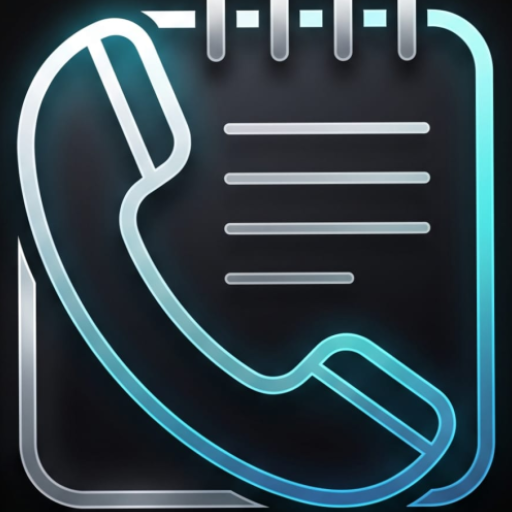
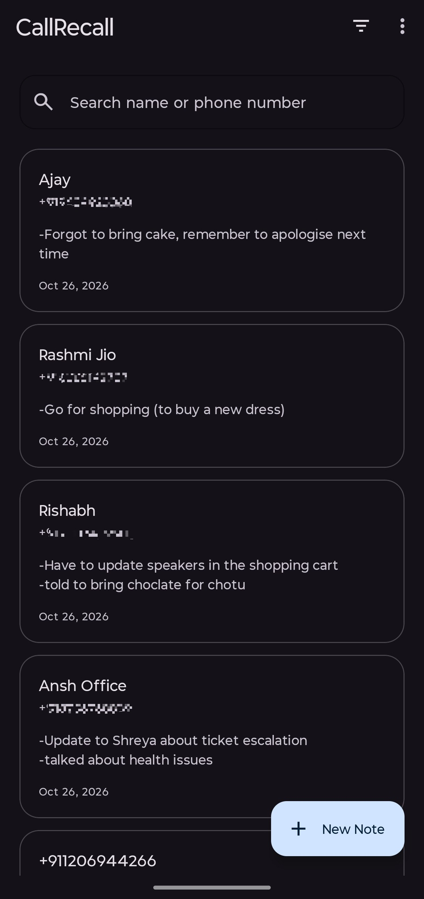
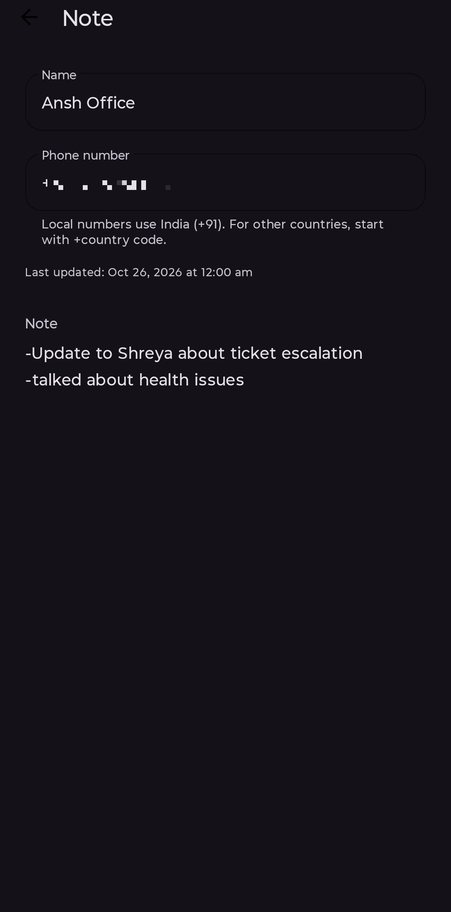
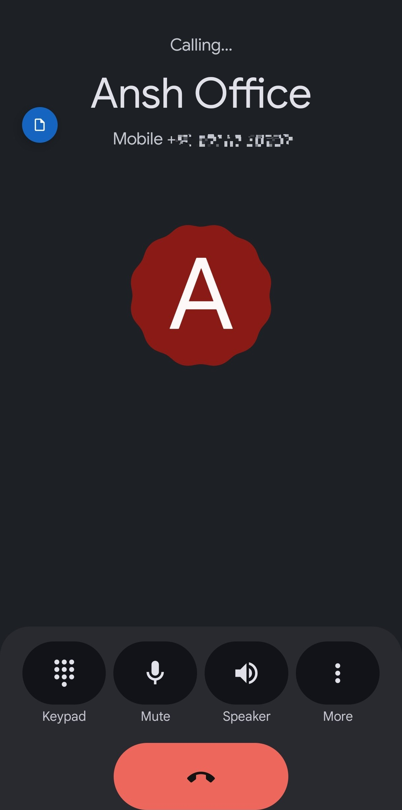
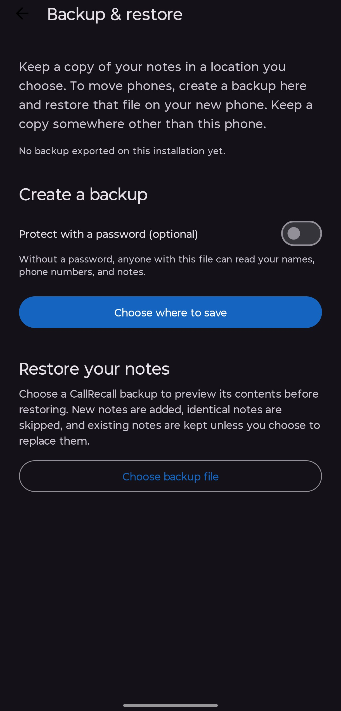

<div align="center">
  

# CallRecall

Remember the conversation. Keep the context.

An Android app for notes linked to phone numbers, with a floating shortcut during calls.

**Android 14+ · Kotlin · Local storage · Optional encrypted backups**

[Releases](https://github.com/abhayhck/CallRecall/releases) · [Report an issue](https://github.com/abhayhck/CallRecall/issues) · [Build from source](#build-from-source)

</div>

## What is CallRecall?

CallRecall helps you remember the details that matter before your next conversation.
Save a follow-up, a reminder, or background information against a phone number. During
an incoming or outgoing phone call, a small floating button lets you open that number’s
note or create one.

Your notes are stored **locally on your device**. You do not need a CallRecall account
or an internet connection to create, search, or edit them.

## Screenshots

<details>
<summary>View app screenshots</summary>

<p align="center">
  
  
  
  
</p>

</details>

<!-- Screenshot files go in docs/screenshots/ using the filenames above. -->

## Features

- **Notes connected to callers:** open an existing note or start a new one from the call bubble.
- **A focused editor:** one name field, a phone number, an autosaving note, and a last-updated timestamp.
- **Contact names:** saved contacts prefill their name; other numbers can be named manually.
- **International numbers:** new notes use a consistent `+country-code-number` format.
- **Search and sorting:** find notes by name or number; sort by name or update date.
- **A movable, dismissible bubble:** drag it anywhere, or drop it on the bottom **×** to dismiss it for that call.
- **Backup and restore:** export your notes to a file, optionally protect it with a password, and restore on another phone.
- **Light and dark themes:** a minimal interface that follows the device theme.

CallRecall does not record call audio or replace your phone’s dialer.

## Install

Download a signed `.apk` from [GitHub Releases](https://github.com/abhayhck/CallRecall/releases)
when one is available. The automatically generated source-code ZIP is not an installable app.

1. Open the APK on a device running **Android 14 or later**.
2. If Android asks, allow installation from the browser or file manager you used.
3. Open CallRecall and follow the permission setup.
4. Enable **Display over other apps** so the floating button can appear during calls.

Call features depend on Android permissions, the installer, and the phone’s background
restrictions. Installing through Android Studio does not guarantee the same permission
behavior as installing a downloaded APK. See [Known limitations](#known-limitations).

## Using the app

### Create and manage notes

Tap **New Note**, then select a contact or enter a phone number. Enter a name if needed
and write your note. Edits save automatically; there is no separate Save button.

Tap a note card to reopen it. Use the search field to find a name or phone number and
the sort menu to change the order. Long-press a card to delete a note after confirmation.

### Use the call bubble

During a supported cellular call, tap the floating button to open the caller’s note.
The note editor stays open independently of the call.

Drag the bubble to reposition it. A bottom **×** target appears while dragging;
release over it to dismiss the bubble for the remainder of that call. It can appear
again on the next call. Dismissing the bubble does not delete the note.

### Enter international numbers

Include `+` and the country code for a number from another country. For local input,
CallRecall uses the SIM country, then the network country, then the device region.
The assumed country is shown beside phone entry.

For example, with India selected automatically, `9876543210`, `919876543210`, and
`+91 98765 43210` resolve to the same `+919876543210` number. Parsing and validation
run locally using [Google libphonenumber](https://github.com/google/libphonenumber).

## Data storage and privacy

**The primary notes database is stored locally in CallRecall’s private app storage,
using Room.** It contains note names, phone numbers, note content, and creation/update
timestamps. CallRecall does not operate its own server or account-based cloud sync,
and it does not include advertising or analytics SDKs.

Phone and contact permissions support call detection and name lookup. When caller
information is unavailable, the app can open a new-note editor; a valid phone number
is required to save a new phone-linked note.

The local database is not separately encrypted by CallRecall. It relies on Android’s
app-storage protections. Password encryption applies to the manual backup file when
you explicitly enable it.

There are two ways data can leave the device:

- **Manual exports:** you choose the destination through Android’s file picker. A cloud-storage provider can upload the file if you select it.
- **Android system backup or device transfer:** these are separate from manual exports and follow the device’s settings. The app requires encryption capability for system cloud backup and excludes device-specific permission/setup history, active-call state, and last-export status.

Uninstalling the app or clearing its storage removes the local notes. Create a backup
first; restoring depends on having an available manual or system backup.

## Backup and restore

Open the toolbar’s **⋮ → Backup & restore** menu.

### Create a backup

Choose **Choose where to save**, then select a location in Android’s file picker.
This can be device storage, an SD card, or a connected document provider available
on the phone. The exported file uses the `.callrecall` extension.

Password protection is **optional and off by default**. Without a password, anyone
with access to the file can read its contents. To encrypt it, enable **Protect with a
password**, enter and confirm a password of at least eight characters, and acknowledge
the warning. You can choose **Without password** instead.

> **Keep your backup password safe.** If you forget it, that encrypted backup cannot
> be recovered. There is no password reset. Creating a backup does not remove the
> notes already on your phone.

Encrypted files use AES-256-GCM with a fresh salt and nonce. The key is derived from
your password using PBKDF2-HMAC-SHA256 with 600,000 iterations. The password is not
saved by the app or included in the file.

Keep a copy somewhere other than the phone itself. The **Last export** date records
a completed write; it does not guarantee that the file still exists or that a cloud
provider has finished uploading it.

### Restore or move to another phone

1. Make your `.callrecall` backup accessible on the destination phone.
2. Open **Backup & restore → Choose backup file**.
3. Enter the original password if the file is encrypted.
4. Review the preview and any conflicting notes.
5. Confirm **Restore notes**.

New notes are added, identical notes are skipped, and conflicts keep your current
note by default. For each conflict, you can compare the two versions and choose
**Use backup** or **Keep current**. Confirmed changes are applied in one database
transaction. If notes change after the preview, the app asks for a fresh review.

Backups preserve names, stored phone numbers, note content, and timestamps. They do
not transfer Android permissions or local database IDs. Older phone-number formats
are preserved, and ambiguous aliases remain separate so notes are not silently merged.
Version-1 backup files remain supported. Current limits are **32 MB per file**,
**8 MB per note body**, and **50,000 notes**.

## Permissions

| Permission or access | Purpose |
| --- | --- |
| Phone state | Detect cellular call state and hide the bubble when the call ends. |
| Call log | Obtain caller-number information and provide a recent-call fallback. |
| Outgoing calls | Obtain the number associated with an outgoing call. |
| Contacts | Select contacts and resolve names for saved phone numbers. |
| Notifications | Show the foreground-service notification during calls. |
| Display over other apps | Display the draggable note button over the call screen. |
| Foreground service | Support call monitoring while a call is active. |

CallRecall explains missing permissions and provides a retry or app-settings route
when appropriate. Manual note entry and backup remain available when call setup is
postponed. The app does not grant itself permissions.

## Known limitations

- Call integration targets **cellular phone calls**. Calls made through third-party messaging/VoIP apps are not supported by the current implementation.
- Hidden/private numbers and short service codes cannot reliably identify a phone-linked note.
- Android and phone-manufacturer restrictions can affect overlays and background execution. The toolbar menu provides **Background activity settings** if needed.
- Android may restrict Call Log and outgoing-call access depending on the installer and device. GitHub distribution does not remove these platform restrictions.
- GitHub release downloads do not provide automatic in-app updates. Install a newer signed APK from Releases when one is published.

The current permission design has not been established as eligible for Google Play
publication. The [release-readiness audit](docs/RELEASE_READINESS.md) records the policy
findings and remaining engineering checks. The planned distribution channel is GitHub Releases.

## Build from source

Requirements: **JDK 17**, **Android SDK Platform 36**, and Android Studio with Kotlin
support. The minimum Android version is **API 34**; the compile and target SDK are **36**.

```bash
git clone https://github.com/abhayhck/CallRecall.git
cd CallRecall
```

Open the project in Android Studio, let Gradle sync, and run the `app` configuration.
Use a physical phone for call and overlay testing. SDK/dependency downloads require
internet access during setup; the app’s core note features do not.

Run unit tests and lint without packaging an APK:

```bash
./gradlew :app:testDebugUnitTest :app:lintDebug
```

For distribution, generate a **signed release APK** in Android Studio. Keep the
keystore and passwords outside the repository, back them up securely, and retain
the signing identity for subsequent updates. Export notes before replacing a
debug-signed installation with a differently signed release.

### Architecture

The app uses **Kotlin**, **XML layouts with View Binding**, **MVVM**, **StateFlow and
coroutines**, and a **Room** database.

```text
app/src/main/java/com/callrecall/
├── activities/    Screens and user interactions
├── adapters/      Note-list binding
├── backup/        Backup format, encryption, and restore planning
├── database/      Room database and DAO
├── models/        Note and sort models
├── receivers/     Cellular call broadcasts
├── repository/    Note persistence, search, and sorting
├── services/      Call-time monitoring service
├── utils/         Overlays, permissions, contacts, and phone normalization
└── viewmodels/    Screen state and operations
```

## Report a problem

Open a [GitHub issue](https://github.com/abhayhck/CallRecall/issues) with your phone
model, Android version, app version, installation method, and steps to reproduce.
For call-related problems, note whether the call was incoming or outgoing and which
permissions were granted. Remove phone numbers, note contents, passwords, and other
personal information from logs and screenshots. Do not attach a personal backup file.

## License

A project license has not been added to this repository yet.
